# 1. Introduction

Drought is a recurring hazard in India, and its impacts come from the interaction between a rainfall deficit and the agricultural and social systems that the deficit affects [@mishra2010; @wilhelmi2002]. Kharif agriculture depends heavily on the June to September southwest monsoon, and year-to-year changes in monsoon rainfall show up directly in crop production [@kumar2004]. One of the main external drivers of these changes is the El Niño-Southern Oscillation (ENSO). Warm El Niño conditions in the tropical Pacific have historically been associated with below-normal Indian monsoon rainfall [@rasmusson1983; @kumar2006], although the link has varied over time and not every El Niño year produces a drought [@kumar1999; @kumar2006].

Maharashtra is a good example of why rainfall alone does not tell us who will be hurt most by a drought. Recurring drought is a major problem in the drought-prone parts of the state, where agriculture, including rainfed cropping and livestock, is the main source of income for much of the population [@udmale2014]. A 50-year district study of Maharashtra found that some districts were vulnerable even with low exposure to climate variability, because of their sensitivity and adaptive-capacity characteristics [@swami2021]. This matches the widely used view of vulnerability as a function of exposure, sensitivity and adaptive capacity [@ipcc2001; @fussel2007].

To combine climate and social information into a single district score, indicators have to be weighted. Expert-based schemes such as the analytic hierarchy process (AHP) are common in Indian drought studies but rest on subjective judgments [@chakraborty2016; @saha2021], while equal weights ignore the overlap between indicators. Principal component analysis (PCA) gives data-driven weights, but it needs care: component signs are arbitrary and, with few districts, the estimated structure can be unstable [@oecd2008; @jolliffe2016]. In addition, few district studies tie vulnerability to El Niño-specific rainfall behaviour or test their results against independent government drought records.

Figure 1.1 shows the El Niño signal in the data used in this project. Each bar is the average June to September rainfall departure of the 34 study districts in one year from 1950 to 2024, and the 18 El Niño monsoon years are shown in red. These years were identified from the Relative Oceanic Niño Index (RONI), the official ENSO index of the U.S. National Oceanic and Atmospheric Administration (NOAA) since February 2026 [@noaaannounce]. In 13 of the 18 El Niño years the average departure was negative, and the mean departure in El Niño years was −7.9 percent, compared with +6.2 percent in the other years. About 30 percent of district monsoons in El Niño years were deficient (20 percent or more below normal), against about 16 percent in other years.

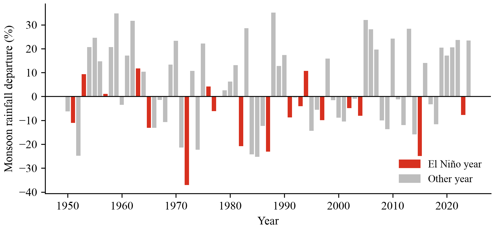{6.0}

This project, "AI-Driven Vulnerability Index Mapping for Districts in Maharashtra to El Niño Droughts Using Socio-Economic and Climatic PCA", addresses these gaps. It builds a reproducible Python pipeline that links 75 years of India Meteorological Department (IMD) gridded rainfall with RONI and with census data, uses PCA to weight six indicators, produces a relative 0 to 100 vulnerability index for 34 districts, groups the districts into Low, Medium and High vulnerability with K-Means clustering, checks the result against Government of Maharashtra drought declarations, and presents everything in maps and an interactive Streamlit dashboard.

# 2. Aim and Objectives

## 2.1 Aim

The aim of the project is to design and develop a transparent, data-driven system that measures how vulnerable each district of Maharashtra is to El Niño-related drought, by combining long-term climatic behaviour with socioeconomic and agricultural conditions. The system uses principal component analysis to weight the indicators, unsupervised machine learning (K-Means clustering) to group districts into vulnerability classes, and maps and a dashboard to communicate the results.

The project also aims to keep every step reproducible and honest about its limits: all data come from official sources, raw files are never edited, every methodological choice is recorded in a configuration file, and the final index is checked against drought declarations that were never used to build it.

## 2.2 Objectives

1. To collect and integrate official district-level climatic and socioeconomic data for Maharashtra, and to derive El Niño-specific rainfall indicators from 75 years of IMD rainfall and NOAA's RONI.
2. To construct a PCA-weighted composite El Niño drought vulnerability index on a 0 to 100 scale for 34 districts, using exposure, sensitivity and adaptive-capacity indicators.
3. To classify the districts into Low, Medium and High vulnerability groups with K-Means clustering, and to validate the results against Government of Maharashtra drought declarations and alternative index versions.
4. To present the index and groups through district maps and an interactive Streamlit dashboard.

# 3. Literature Survey

## 3.1 Related Work

1. **IPCC (2001) and Füssel (2007):** The Third Assessment Report of the Intergovernmental Panel on Climate Change described vulnerability as a function of exposure, sensitivity and adaptive capacity [@ipcc2001], and Füssel set out a general conceptual framework for vulnerability in climate research [@fussel2007].
> **Comment:** These works give the conceptual structure of the project. Every indicator in our index is assigned to one of the three dimensions, and its direction (whether a higher value means more or less vulnerability) follows this framework.
2. **Rasmusson and Carpenter (1983); Kumar et al. (1999, 2006):** These studies established the link between warm eastern Pacific sea surface temperatures and below-normal Indian monsoon rainfall, and showed that the relationship has weakened at times and depends on the type of El Niño [@rasmusson1983; @kumar1999; @kumar2006].
> **Comment:** They justify treating El Niño as a drought exposure factor, but also warn that not every El Niño year is a drought. This is why we measure both the average rainfall response to RONI and how often El Niño monsoons were actually deficient in each district.
3. **Swami and Parthasarathy (2021):** This study assessed agricultural vulnerability for Maharashtra districts over 1966 to 2015 using exposure, sensitivity and adaptive-capacity indicators combined with equal weights [@swami2021].
> **Comment:** It is the closest district-level study of the state. It showed that sensitivity and adaptive capacity matter even where exposure is low, but its weights are equal and its exposure is not linked to ENSO.
4. **Nair and Mirajkar (2022):** This paper assessed drought vulnerability across the Vidarbha region of Maharashtra [@nair2022].
> **Comment:** It covers only one region of the state. Our project covers all 34 districts for which the required data exist, so that regions such as Marathwada and Vidarbha can be compared on one scale.
5. **Chakraborty and Joshi (2016); Saha et al. (2021):** These studies mapped disaster vulnerability of Indian districts with AHP, and drought vulnerability in Odisha with fuzzy AHP [@chakraborty2016; @saha2021].
> **Comment:** AHP depends on expert judgments, which are hard to reproduce. This motivated the use of a statistical weighting method in our project.
6. **Murthy et al. (2015); Sharma and Ravindranath (2019):** Murthy et al. built a composite agricultural drought vulnerability index with geospatial data, and Sharma and Ravindranath applied the IPCC 2014 framework to hazard-specific assessment [@murthy2015; @sharma2019].
> **Comment:** They show how physical and social indicators can be combined into one index for Indian conditions, which is the general approach followed in this project.
7. **Cutter et al. (2003); Abson et al. (2012):** Cutter et al. built the Social Vulnerability Index with factor analysis, and Abson et al. used PCA for socio-ecological vulnerability mapping in Southern Africa [@cutter2003; @abson2012].
> **Comment:** These are the standard references for using PCA-type methods in vulnerability mapping. They also show that the meaning of a component has to be interpreted carefully before it is used as a score.
8. **Balaganesh et al. (2020); Kim et al. (2021):** Balaganesh et al. derived PCA weights for a district drought vulnerability index for Tamil Nadu, and Kim et al. combined PCA with a Gaussian mixture model for drought risk in South Korea [@balaganesh2020; @kim2021].
> **Comment:** They support PCA weighting followed by grouping of districts, which is the structure of our pipeline (PCA weights, then K-Means groups).
9. **Nardo et al. (2008), OECD and JRC handbook:** The handbook on composite indicators explains weighting methods, including PCA and factor analysis, and the checks needed before using them, such as the Kaiser-Meyer-Olkin (KMO) measure and Bartlett's test [@oecd2008; @kaiser1974].
> **Comment:** Our retention rules, factorability checks and the factor-analysis comparison version all follow this handbook.
10. **Uzcategui-Salazar and Lillo (2023); Lloyd (1982):** Uzcategui-Salazar and Lillo used K-Means to classify social vulnerability, and Lloyd described the least-squares algorithm behind K-Means [@uzcategui2023; @lloyd1982].
> **Comment:** They support using K-Means to form vulnerability classes. In our project K-Means is applied only to the final index, so that it finds natural gaps in the index instead of fixed cut-offs.

Table 3.1 summarises further studies that were reviewed for the project, with the method, data, main finding and gap of each.

TABLE: Table 3.1: Summary of the literature survey
| Sr. No. | Name of the Publication / Journal | Title of the Research Paper | Objective / Problem Discussed | Methodology | Dataset / Tools Used | Key Findings | Research Gap |
| 1 | Hydrology Research (2026) | Sustainable drought resilience strategies in India | Review national drought frameworks | Literature review | Policy and climate data | 60% of districts face water stress by 2030 | Conceptual only; lacks local quantitative metrics |
| 2 | Environ Dev Sustain (2025) | Household vulnerability index to drought in Tamil Nadu | Assess rural household vulnerability | PCA | Surveys and climate data | Ramanathapuram most vulnerable (0.86) | Limited to Tamil Nadu; no Maharashtra district mapping |
| 3 | Global NEST Journal (2024) | Maharashtra river basin flood-drought nexus | Analyse river basin water scarcity | Qualitative case study | Rainfall and urban metrics | Found distinct regional scarcity patterns | Lacks quantitative indexing and ML clustering |
| 4 | Water, MDPI (2023) | Drought vulnerability in north-west Odisha via Fuzzy-AHP | Map basin-level drought risk | Fuzzy-AHP | GIS and demographic data | Mapped 33% of the area as high drought risk | Subjective AHP weights; no unsupervised ML |
| 5 | Food Security (2023) | 2023-24 El Niño impact on India's food security | Evaluate El Niño agricultural risk | Economic modelling | ONI and crop yield data | Over 70% of districts suffer crop yield drops | National scope; lacks district mapping |
| 6 | Stoch Environ Res Risk Assess (2023) | Ensemble ML-based drought index in Odisha | Predict village drought vulnerability | Ensemble ML (M5P) | 53 spatial indicators | High risk in 37.9% of sampled regions | Complex model; no unsupervised clustering |
| 7 | Gondwana Research (2022) | National drought vulnerability assessment | Map multidimensional drought risk | AHP and ML regression | Climate and census data | Socio-economic drought threatens food security | Manual weighting; no unsupervised ML grouping |
| 8 | Arab J Geosci (2022) | Drought vulnerability in Vidarbha, Maharashtra | Assess regional drought intensity | SPI and SPEI indices | Historic IMD rainfall | High drought severity in east Vidarbha | Index-based; stopped short of K-Means |
| 9 | J King Saud Univ Sci (2022) | Drought vulnerability in Kangsabati basin | Delineate basin hazard zones | GIS-based AHP | Remote sensing and GIS | Mapped 21.1% of the area as high risk | Subjective AHP bias; lacks objective weighting |
| 10 | Geomatics Nat Haz Risk (2021) | Spatial drought assessment via Fuzzy-AHP | Map state-wide vulnerability | Fuzzy-AHP | Weather and census data | 33.94% of the area mapped as high risk | Expert-dependent weights; no ML clustering |
| 11 | Natural Hazards (2021) | Regional drought vulnerability and risk using PCA and GMM | Objectively weight drought vulnerability indicators | PCA, GMM, equal weighting | Chungcheong Province, South Korea | PCA gave larger weights to agricultural and industrial factors | Not El Niño-specific; outside India |
| 12 | PLOS One (2026) | Territorial composite vulnerability index, Cali | Guide public health action by territory | PCA weights from eigenvalues and absolute loadings | 7 socio-economic indicators, Cali, Colombia | 3 components (67.9% variance); KMO 0.60 | Urban health focus; no climate hazard |

## 3.2 Research Gap

The main gaps found in the literature are as follows.

- **Exposure is not tied to El Niño:** Most district vulnerability studies in India use general rainfall or drought indices. Few derive exposure from how each district's monsoon has actually behaved in El Niño years.
- **Subjective or sign-unsafe weights:** Expert (AHP) and equal weights are common. Where PCA is used, the arbitrary sign of components can give an indicator a weight in the wrong direction, and factorability with few districts is rarely reported.
- **No independent validation:** Indices are rarely checked against an outside record such as official drought declarations, and almost never against a year kept aside until the index is fixed.
- **Limited accessibility:** Results are usually published as static maps in papers, with no tool that lets a planner or student explore a particular district.

## 3.3 Summary

The literature agrees on the exposure, sensitivity and adaptive-capacity framework and shows that PCA and clustering are useful for composite vulnerability mapping. However, El Niño-specific exposure, sign-safe statistical weights, independent validation and accessible presentation are rarely combined. This project brings these together for Maharashtra at district level.

# 4. Social Impact / Effect of Problem

Drought in Maharashtra is not only a weather event. It affects incomes, food supply, drinking water, livestock, migration and the finances of the state. A survey of farmers in drought-prone Maharashtra documented how drought affects their crops, livestock and incomes, and how farmers rely on local adaptation and on government mitigation measures [@udmale2014]. Because most kharif crops in the state are rainfed, a weak monsoon quickly turns into a livelihood problem [@kumar2004].

The data used in this project show how large this dependence is. Across the 34 study districts, an average of 64.9 percent of workers are cultivators or agricultural labourers (Census 2011), 81.2 percent of net sown area is rainfed (Census 2011 Village Directory) and 77.1 percent of land holdings are below 2 hectares (Agriculture Census 2010-11). In the most dependent districts the figures are much higher: the agricultural-worker share reaches 83.5 percent and the rainfed share 97.8 percent. Small and marginal farmers on rainfed land have the least capacity to absorb a lost season.

The scale of drought declarations shows the effect on the state. In the kharif season of 2018 the Government of Maharashtra declared drought in 151 talukas [@gr2018], and separate orders added 268 revenue circles. In 2023, an El Niño year, 40 talukas were declared in the main order [@gr2023], and further orders added more than 1,000 revenue circles (counts from the project's transcription of the orders). In September 2026, 265 talukas across 32 of the 34 districts were placed under the first drought trigger [@gr2026]. Each declaration leads to relief measures such as land revenue waivers, crop loss compensation and water tankers, following the national Manual for Drought Management [@dmm2016].

Figure 4.1 maps the 2018 declarations. The declared talukas are concentrated in the interior of the state, especially Marathwada and parts of western and northern Maharashtra, while the coastal districts and east Vidarbha are less affected. The same pattern appears in the vulnerability index developed in this project (Chapter 8).

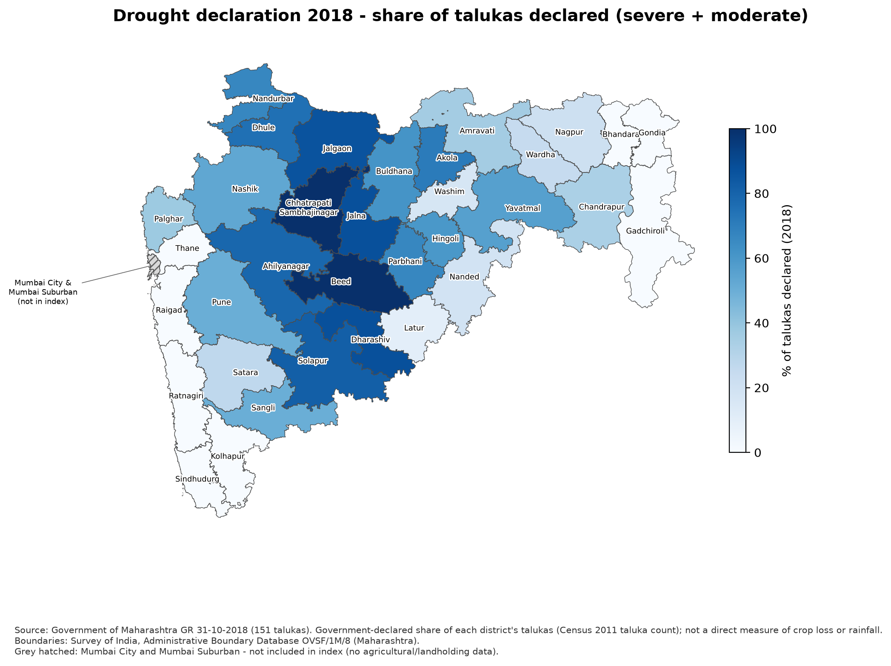{4.2}

El Niño adds a predictable element to this risk. NOAA issues ENSO outlooks months before the monsoon, so an El Niño forecast can warn planners in advance. What is usually missing is a clear answer to the question "if El Niño weakens the monsoon, which districts will suffer most?" Relief and preparation are often spread by administrative routine rather than by vulnerability.

A district vulnerability index helps here in several ways:

- **Preparedness:** When an El Niño is forecast, high-vulnerability districts can be prioritised for contingency crop plans, fodder banks and water supply arrangements.
- **Fair allocation:** A transparent, data-driven ranking makes it easier to explain why some districts receive more attention.
- **Long-term planning:** The indicators show why a district is vulnerable (for example, high rainfed share or low literacy), which points to long-term measures such as irrigation, crop insurance and education.

At the same time, a poorly built index could mislead planners. This is why the project reports its limitations openly: the index is relative to the 34 districts, it is not a probability of drought, and it should support, not replace, field information and official drought assessment.

# 5. System Design

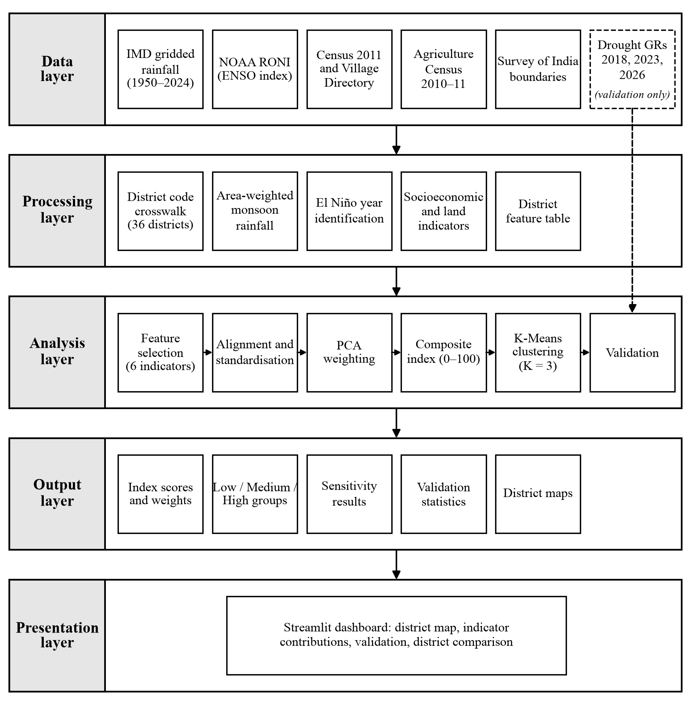{6.0}

The system is organised as a layered data pipeline in which each stage reads the outputs of the previous stage and writes its own results to disk (Figure 5.1). This arrangement allows every intermediate table to be inspected and any single stage to be re-run without repeating the whole analysis. Raw files are treated as read-only, districts are matched on numeric Census 2011 and Local Government Directory codes rather than on names, and each methodological choice is recorded in a configuration file before it is applied.

## 5.1 Architecture Overview

The architecture has five layers. The data layer holds the official source files exactly as they were downloaded. The processing layer converts these files into district-level indicators, and the analysis layer performs feature selection, principal component analysis, index construction, clustering and validation. The output layer stores the resulting tables, reports and maps. Finally, the presentation layer, a Streamlit dashboard, displays these outputs without recomputing them.

## 5.2 Data Layer

Seven sources are used (Table 5.1). Each raw file is listed in a source manifest with its URL, download date, size and SHA-256 checksum, so that a later user can confirm that the same files were used.

TABLE: Table 5.1: Data sources used in the system
| Source | Content used | Period |
| IMD 0.25° gridded daily rainfall [@pai2014] | June to September rainfall for each district | 1950 to 2024 |
| NOAA CPC Relative Oceanic Niño Index [@noaaroni] | ENSO index, El Niño years | 1950 to 2024 |
| Census 2011 Primary Census Abstract [@census2011] | Workers by category, literacy | 2011 |
| Census 2011 Village Directory [@censusvd] | Net sown and irrigated area of 43,665 villages | 2011 |
| Agriculture Census 2010-11 [@agcensus2014] | Number of holdings by size class | 2010-11 |
| Survey of India boundaries [@soi] | District polygons for rainfall and maps | Current |
| Drought GRs, Government of Maharashtra [@gr2018; @gr2023; @gr2026] | Declared talukas (validation only) | 2018, 2023, 2026 |

The drought declarations in the last row of Table 5.1 are kept out of model building and are used only to validate the final index.

## 5.3 Processing Layer

The processing layer begins with a district crosswalk that maps Census 2011 codes to the 36 present-day districts. Palghar, which was separated from Thane in 2014, has no Census 2011 district code of its own and is therefore rebuilt from its eight Census 2011 talukas in every source. Mumbai City and Mumbai Suburban have no villages in the Village Directory and no holdings in the Agriculture Census, so the agricultural indicators cannot be computed for them. Both districts remain in the tables but are excluded from the index, which leaves 34 districts.

Gridded daily rainfall is aggregated to districts with area weights, and monsoon totals and departures from the 1971 to 2020 normal are calculated for every year from 1950 to 2024. El Niño monsoon years are identified from RONI with NOAA's operational rule. The census, Village Directory and Agriculture Census tables are reduced to district indicators and combined into a single feature table with one row per district.

## 5.4 Analysis Layer and Indicator Framework

The indicator framework follows the exposure, sensitivity and adaptive-capacity structure of vulnerability [@ipcc2001]. An audit of 30 candidate variables removed exact duplicates, alternative denominators and variables without a clear direction, leaving the six indicators in Table 5.2. Exposure is represented by two El Niño rainfall indicators, sensitivity by three agricultural indicators and adaptive capacity by literacy.

TABLE: Table 5.2: Final indicators, vulnerability dimensions and directions
| No. | Indicator (unit) | Dimension | Sign | Source |
| 1 | ENSO rainfall slope (% per °C) | Exposure | −1 | IMD, RONI |
| 2 | El Niño deficient frequency (fraction) | Exposure | +1 | IMD, RONI |
| 3 | Agricultural-worker share (% of workers) | Sensitivity | +1 | Census 2011 |
| 4 | Rainfed share of net sown area (%) | Sensitivity | +1 | Village Directory 2011 |
| 5 | Small-holding share, below 2 ha (%) | Sensitivity | +1 | Agriculture Census 2010-11 |
| 6 | Literacy rate, age 7 and above (%) | Adaptive capacity | −1 | Census 2011 |
NOTE: Sign is the multiplier applied so that a higher aligned value means greater vulnerability.

The indicators are aligned with the signs in Table 5.2 and standardised. PCA is then used only to obtain indicator weights, the weighted sum is rescaled to a 0 to 100 index, and K-Means clustering assigns each district to a Low, Medium or High group. The validation module compares the fixed index with the share of talukas declared drought-affected in 2018, 2023 and 2026. These steps are described in detail in Chapter 7.

## 5.5 Output and Presentation Layers

The analysis layer writes its results as CSV tables in data/processed/, as a Markdown report for each stage in reports/ and as district maps in outputs/maps/. The Streamlit dashboard (app.py) reads these files directly. It shows a district map that can be coloured by group or by index value, a summary card for a selected district, the contribution of each indicator to that district's score, the validation results and a comparison of any two districts. Because the dashboard performs no calculations of its own, the values it displays are identical to those reported in Chapter 8.

## 5.6 Reproducibility

Methodological choices, such as RONI or ONI, current or 2011 district boundaries, and the PCA weighting scheme, are recorded in config/project_decisions.yaml together with the options considered, the option adopted and the reason for it. The alternatives are still computed and are used in the sensitivity analysis of Chapter 8. Random seeds are fixed and automated tests check the main steps of the pipeline. With the source manifest, this allows the complete analysis to be reproduced from the raw files.

## 5.7 Summary

The system is a five-layer pipeline that turns seven official data sources into a district vulnerability index, Low, Medium and High groups, maps and a dashboard. The processing layer reduces the raw files to six indicators for 34 districts, the analysis layer weights them with PCA and groups the districts with K-Means, and the drought declarations are used only at the end to validate the result. Because every stage writes its output to disk and every methodological choice is recorded, each step can be checked and re-run on its own.

# 6. Flow Chart

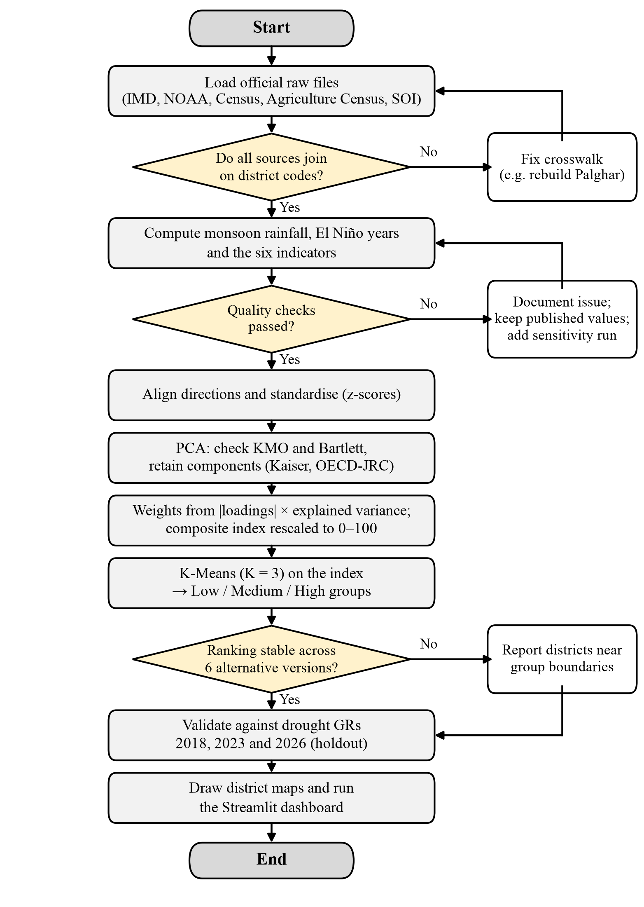{4.9}

The flowchart in Figure 6.1 shows the sequence of operations from the raw data to the final maps and dashboard, including the checks at which the process can loop back.

The process starts by loading the official raw files: IMD gridded rainfall, the NOAA ENSO index, the Census 2011 tables, the Agriculture Census report and the Survey of India boundaries. The first decision checks whether all sources can be joined on numeric district codes. If they cannot, the district crosswalk is corrected before going further. The main case in this project was Palghar, which did not exist in 2011 and had to be rebuilt from its eight Census 2011 talukas in every source.

Once the sources are joined, the system computes June to September rainfall for each district and year, identifies El Niño monsoon years and derives the indicators. A second decision checks data quality. When a problem is found, it is documented and handled without editing the raw file. Two examples were found: the irrigated and unirrigated columns of the Village Directory are swapped, so the code maps them explicitly, and some IMD rainfall values for Pune are implausibly high, so they were kept as published and an extra sensitivity version without them was added.

After the quality checks, the six indicators are aligned so that a higher value always means more vulnerability and standardised to z-scores. PCA is then run, with the KMO measure and Bartlett's test reported and the number of components chosen with standard retention rules. The indicator weights are calculated from the absolute loadings of the retained components multiplied by their explained variance, and the weighted sum is rescaled to a 0 to 100 index. K-Means clustering with K = 3 is applied to the index to form the Low, Medium and High groups.

The third decision checks whether the ranking is stable when the index is rebuilt with six alternative methods. Where districts change group between versions, they are reported as boundary cases rather than hidden. The fixed index and groups are then compared with the drought declarations of 2018 and 2023 and with the 2026 holdout. Finally, the district maps are drawn and the Streamlit dashboard is run, and the process ends.

# 7. System Implementation

The system is implemented in Python as a sequence of numbered scripts (src/s01 to src/s19) that are run in order by src/run_pipeline.py. The code is kept simple and readable, using pandas for tables and scikit-learn for the machine learning steps.

## 7.1 Technologies Used

TABLE: Table 7.1: Technologies and libraries used
| Purpose | Technology |
| Programming language | Python 3.12 |
| Data handling | pandas, NumPy, openpyxl |
| Gridded rainfall (NetCDF) | xarray, netCDF4 |
| District boundaries and maps | GeoPandas, Shapely, pyogrio, Matplotlib |
| Statistics | SciPy |
| Machine learning (standardisation, PCA, K-Means) | scikit-learn [@pedregosa2011] |
| Decision file | YAML (PyYAML) |
| Dashboard | Streamlit |
| Testing | pytest (56 test functions) |
| Version control | Git |

## 7.2 Pipeline Modules

TABLE: Table 7.2: Main pipeline modules
| Module | Function |
| s01_crosswalk | District code crosswalk, Palghar reconstruction |
| s02 to s04 | Census, Village Directory and Agriculture Census indicators |
| s05_rainfall | Area-weighted district rainfall, monsoon departures |
| s06_enso | El Niño years with NOAA's rule (RONI and ONI) |
| s07 to s09 | Climate indicators, validation shares, merged feature table |
| s11_feature_selection | Audit of 30 candidates, final six indicators |
| s12 and s13 | PCA input, PCA with retention and stability diagnostics |
| s14 and s15 | Rainfall sensitivity, comparison of weighting methods |
| s16_vulnerability_index | Final weights and 0 to 100 index |
| s17_kmeans_classification | K-Means groups and diagnostics |
| s18_drought_validation | Spearman correlation with drought declarations |
| s19_maps | District maps |
| app.py | Streamlit dashboard |

## 7.3 Data Preprocessing

Each 0.25 degree rainfall grid cell is represented by its box around the grid point. The weight of a cell for a district is the area of the box that falls inside the district polygon, calculated in an equal-area projection. Daily district rainfall is the area-weighted mean of the cells, and the monsoon total of district *i* in year *y* is the sum over June to September. The baseline is the district's own mean monsoon rainfall for 1971 to 2020, IMD's current normal period, and the percentage departure is

$$departure$$

Two data-quality problems were handled in code without changing the raw files. In the Village Directory, the irrigated and unirrigated area columns are interchanged: the irrigated areas by source add up to the column labelled unirrigated in 43,661 of 43,665 villages, so the code maps the columns explicitly. In the IMD grid, ten district-years exceed twice the district baseline, for example Pune in 2005 (4.87 times). These values were kept as published, and a sensitivity version without Pune's two flagged years was built. No values were imputed.

## 7.4 ENSO and Rainfall Indicators

El Niño seasons are identified with NOAA's rule: the three-month index, rounded to 0.1 °C, is at least +0.5 °C for at least five consecutive overlapping seasons. Our implementation reproduces all 919 seasons of NOAA's published ONI table and 915 of 919 seasons of the RONI table (the four differences are in a 1984 La Niña run and do not affect any El Niño season). A year is an El Niño monsoon year when both the June to August and July to September seasons fall in a warm episode, which gives 18 El Niño monsoon years between 1950 and 2024.

The first exposure indicator is the least-squares slope of the departure on the monsoon RONI value over all 75 years:

$$slope$$

A negative slope means that warmer ENSO conditions have been associated with lower monsoon rainfall in that district. The second indicator is the share of the 18 El Niño years in which the departure was −20 percent or lower, the limit of IMD's deficient category.

## 7.5 Direction Alignment and Standardisation

The ENSO slope and literacy are multiplied by −1 and the other four indicators by +1, so that a higher value always means more vulnerability. Each aligned indicator is then standardised over the 34 districts with scikit-learn's StandardScaler:

$$zscore$$

## 7.6 Principal Component Analysis

PCA is applied to the 34 × 6 standardised matrix, which is the same as the eigen-decomposition of the correlation matrix **R** [@jolliffe2016]:

$$pca$$

The loading of indicator *j* on component *k* is its correlation with the component:

$$loading$$

The number of components is chosen with the Kaiser rule (eigenvalue above 1) [@kaiser1960] and the OECD and JRC rules (each component above 10 percent of variance, cumulative share above 60 percent) [@oecd2008]. Horn's parallel analysis [@horn1965] and a leave-one-district-out refit are used as diagnostics, and factorability is summarised by the KMO measure [@kaiser1974] and Bartlett's test.

## 7.7 Vulnerability Index Construction

PCA is used only to find the weights; the index itself is not a principal component. With three retained components, the raw and normalised weights are

$$rawweight$$

$$weight$$

Absolute loadings are used because the sign of a principal component is arbitrary, while the direction of each indicator is fixed by the alignment step. The district score and the rescaled index are

$$score$$

$$index$$

Because the scaling uses the observed minimum and maximum, the index is relative: 0 is the least vulnerable of the 34 districts, not zero vulnerability, and the index is not a probability. Six alternative versions (equal weights, factor-analysis weights, hazard and social sub-indices, all six components, Pune's flagged years removed, and ONI instead of RONI) are built for the sensitivity analysis.

## 7.8 K-Means Classification

K-Means [@lloyd1982] is applied to the final 0 to 100 index only. It minimises the within-group sum of squares:

$$kmeans$$

The scikit-learn implementation is used with K = 3, random_state = 2026 and n_init = 20, so the result is reproducible. Because K-Means numbers clusters arbitrarily, the clusters are sorted by centroid and labelled Low, Medium and High. The silhouette coefficient [@rousseeuw1987], solutions for K = 2 and K = 4 and a tertile split are computed as diagnostics.

## 7.9 Drought-Declaration Validation

For each district and year, the declared share is the number of talukas declared drought-affected in the main Government Resolution divided by the number of Census 2011 talukas:

$$share$$

The main statistic is Spearman's rank correlation between the index and the declared share across the 34 districts. Group means of the share are a second check.

## 7.10 Dashboard Implementation

The dashboard (app.py) loads the fixed CSV files and the Survey of India boundaries once and caches them. A drop-down list selects a district; the map, district card, indicator table and validation figures update for that district. A radio button switches the map between the group view and the continuous index view, and a second pair of drop-down lists compares any two districts. The dashboard is deployed on Streamlit Community Cloud and is available at https://maharashtra-elnino-vulnerability.streamlit.app. Figures 7.1 to 7.4 show the main parts of the dashboard.

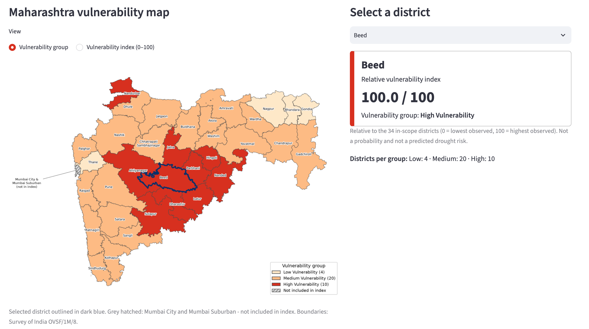{6.2}

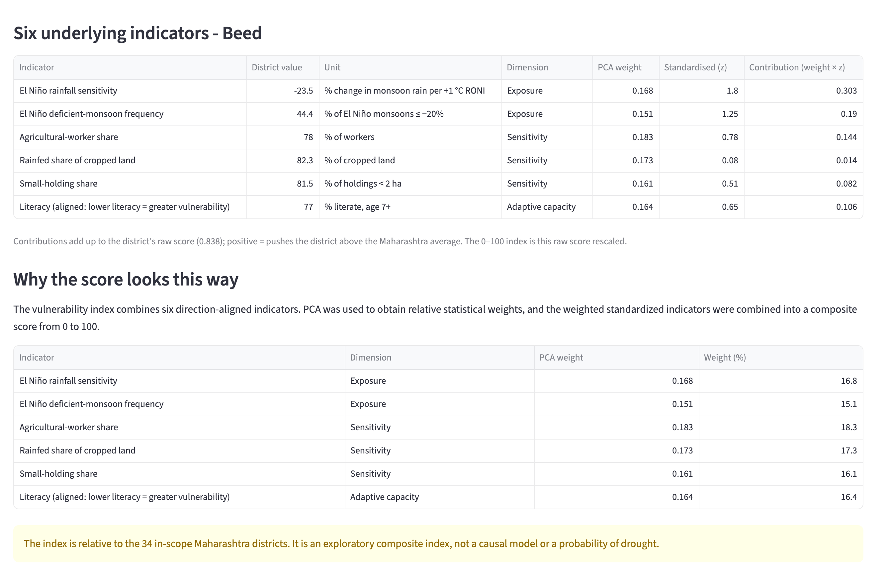{6.2}

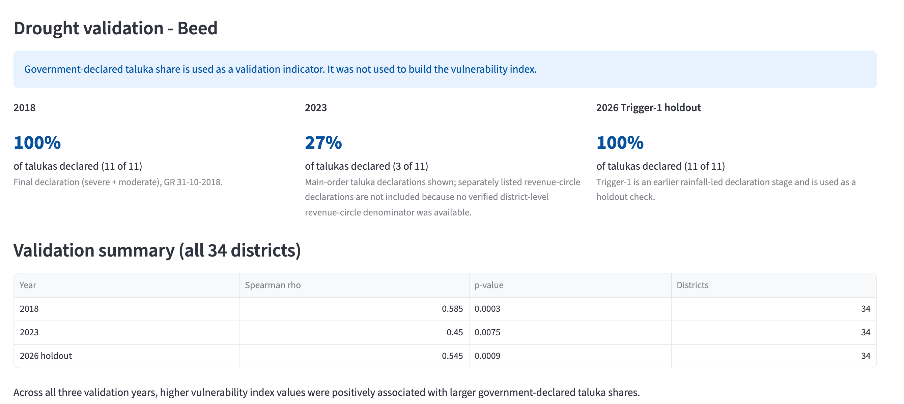{6.2}

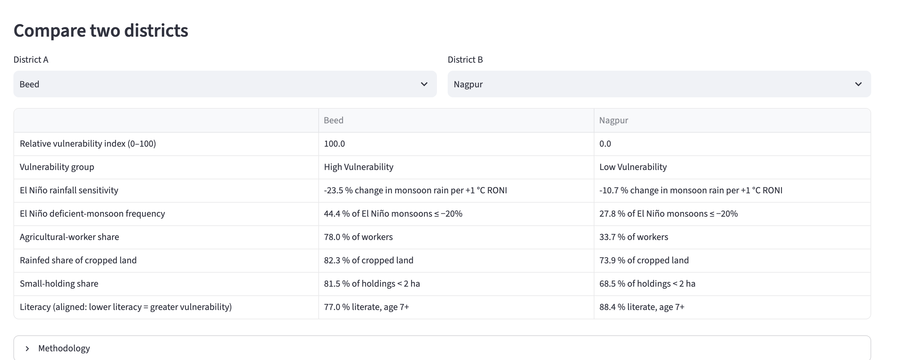{6.2}

## 7.11 Testing

The repository contains 56 pytest test functions covering the pipeline, feature selection, PCA, the weighting methods, the index, K-Means, validation, maps and the dashboard. For example, the tests check that the weights sum to one, that the index runs from 0 to 100, that the K-Means groups are ordered by centroid and that the drought declarations are not used before the validation stage.

# 8. Results and Analysis

## 8.1 PCA Results

The six indicators share little common structure. The KMO measure is 0.40, below the value of 0.6 usually recommended for PCA-based weighting [@oecd2008], although Bartlett's test rejects an identity correlation matrix (χ² = 35.5, 15 degrees of freedom, p = 0.002). This is mainly a result of feature selection, which removed overlapping indicators. It means that the PCA weights should be read as exploratory statistical weights, not as evidence of one strong underlying vulnerability factor.

TABLE: Table 8.1: PCA eigenvalues and explained variance
| Component | Eigenvalue | EVR (%) | Cumulative (%) | Parallel analysis 95th pct. |
| PC1 | 2.056 | 34.3 | 34.3 | 1.874 |
| PC2 | 1.246 | 20.8 | 55.0 | 1.465 |
| PC3 | 1.165 | 19.4 | 74.5 | 1.194 |
| PC4 | 0.663 | 11.1 | 85.5 | 0.994 |
| PC5 | 0.616 | 10.3 | 95.8 | 0.819 |
| PC6 | 0.253 | 4.2 | 100.0 | 0.636 |
NOTE: EVR: explained-variance ratio. Parallel analysis uses 5,000 random 34 × 6 data sets.

Three components have eigenvalues above 1 and together explain 74.5 percent of the variance, so the Kaiser and OECD and JRC rules both retain three (Table 8.1, Figure 8.1). Horn's parallel analysis retains only PC1, which reflects the uncertainty of a 34-district sample. The leave-one-district-out analysis shows that PC1 is very stable (median absolute cosine 0.999).

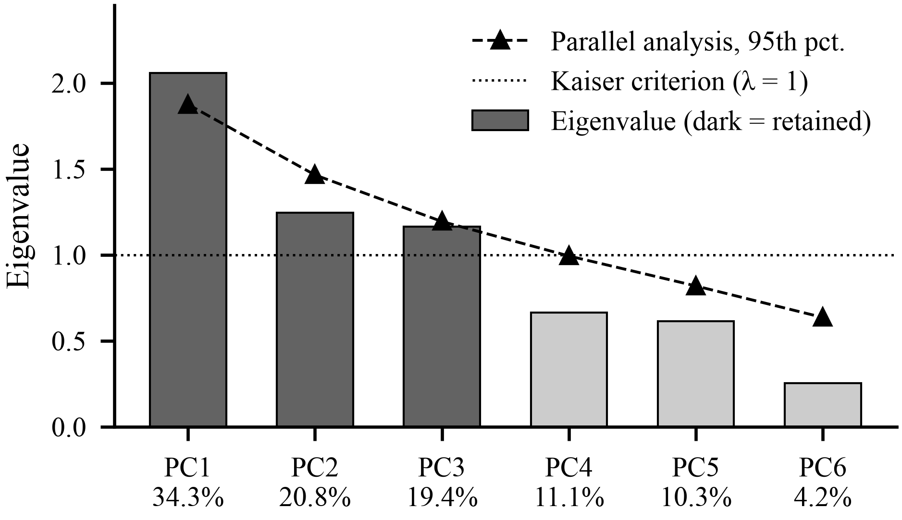{3.6}

PC1 has a clear regional meaning (Figure 8.2). It loads positively on the ENSO slope (0.74), agricultural-worker share (0.71) and low literacy (0.67) and negatively on the small-holding share (−0.66). It contrasts the dry agricultural interior, where El Niño rainfall losses are large, with coastal and eastern districts where small holdings are common. PC2 is dominated by the deficient frequency (0.88), and PC3 contrasts rainfed cropping (0.69) with agricultural employment (−0.53).

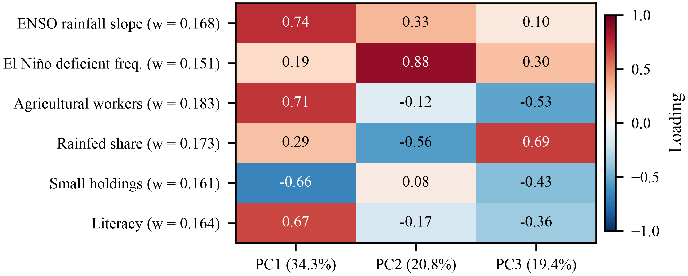{4.4}

## 8.2 Indicator Weights

TABLE: Table 8.2: Final PCA-derived indicator weights
| Indicator | L1 | L2 | L3 | Raw weight | Weight |
| ENSO rainfall slope | 0.739 | 0.329 | 0.102 | 0.341 | 0.168 |
| El Niño deficient frequency | 0.192 | 0.880 | 0.303 | 0.307 | 0.151 |
| Agricultural-worker share | 0.712 | −0.119 | −0.529 | 0.372 | 0.183 |
| Rainfed share | 0.290 | −0.562 | 0.690 | 0.350 | 0.173 |
| Small-holding share | −0.661 | 0.080 | −0.425 | 0.326 | 0.161 |
| Literacy | 0.667 | −0.166 | −0.356 | 0.332 | 0.164 |
NOTE: Example for the ENSO slope: raw weight = 0.343 × 0.739 + 0.208 × 0.329 + 0.194 × 0.102 = 0.341; weight = 0.341 / 2.029 = 0.168.

All six weights are positive and lie between 0.151 and 0.183, close to the equal weight of 0.167 (Table 8.2). Agricultural-worker share and rainfed share get the largest weights and the deficient frequency the smallest. The near-equal weights follow from the weak correlation between the indicators: PCA finds no strong reason to weight one indicator far above the others, so the index uses climatic, agricultural and socioeconomic information in similar proportions.

## 8.3 Vulnerability Index

The index has a mean of 52.8, a median of 47.5 and an interquartile range of 38.2 to 68.5. Beed has the highest score (100) and Nagpur the lowest (0). Beed combines a rainfall slope of −23.5 percent per °C, deficient monsoons in 8 of 18 El Niño years, an agricultural-worker share of 78.0 percent, a rainfed share of 82.3 percent and literacy of 77.0 percent. Nagpur has an agricultural-worker share of 33.7 percent, literacy of 88.4 percent and a weaker slope of −10.7 percent per °C. Figure 8.3 maps the index, and Figure 8.5 ranks all 34 districts.

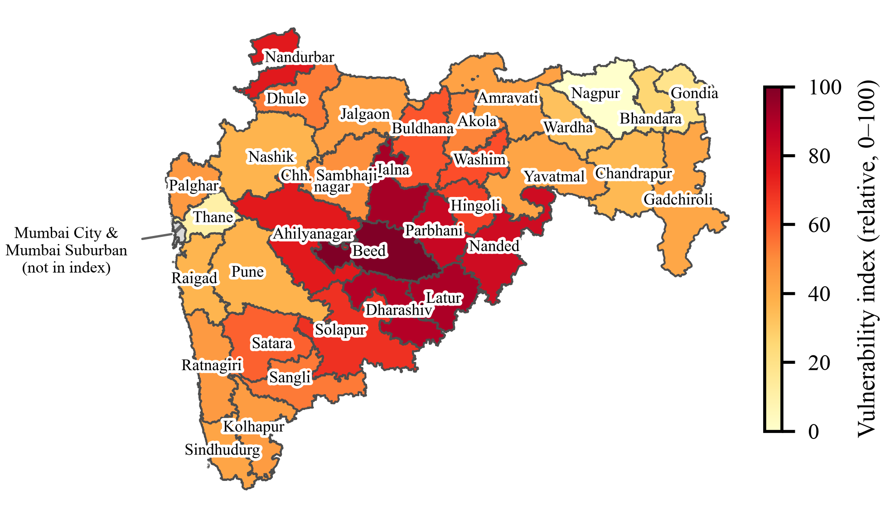{4.8}

## 8.4 Low, Medium and High Vulnerability Groups

TABLE: Table 8.3: K-Means vulnerability groups (K = 3)
| Group | Districts | Centroid | Index range | Members |
| High | 10 | 82.4 | 65.9 to 100.0 | Beed, Jalna, Latur, Dharashiv, Parbhani, Nanded, Nandurbar, Ahilyanagar, Solapur, Hingoli |
| Medium | 20 | 45.9 | 32.6 to 62.7 | Remaining 20 districts |
| Low | 4 | 13.8 | 0.0 to 25.6 | Bhandara, Gondia, Thane, Nagpur |
NOTE: Group boundaries lie at 29.8 and 64.1. Silhouette coefficient 0.587.

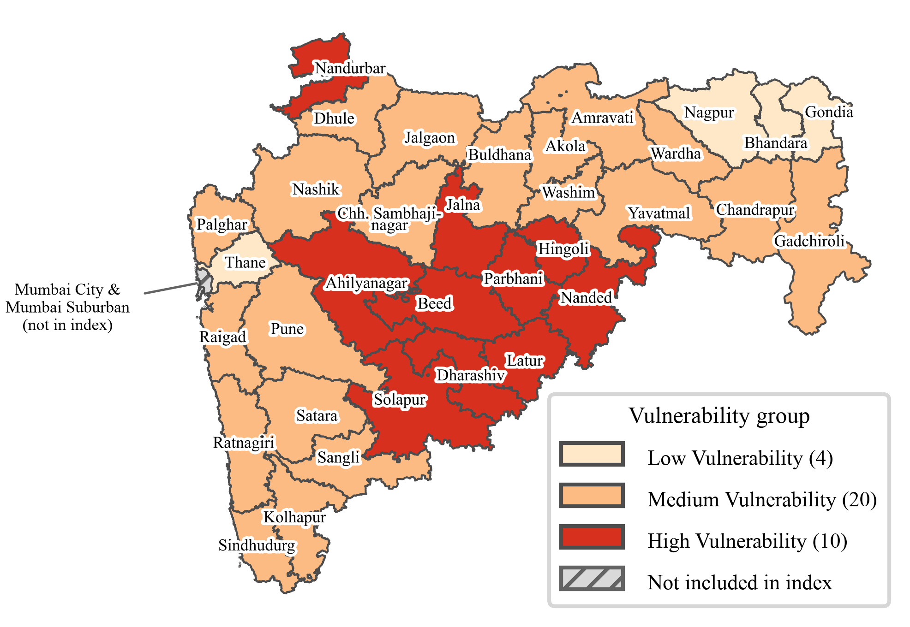{4.8}

Seven of the eight Marathwada districts are in the High group (Figure 8.4); the eighth, Chhatrapati Sambhajinagar, is Medium (49.1). The High group also includes Ahilyanagar and Solapur in the dry interior and Nandurbar in the north-west, which has the lowest literacy rate of the 34 districts (64.4 percent). On average, High-group districts have an ENSO slope of −19.9 percent per °C against −8.0 percent per °C in the Low group, and literacy of 75.2 percent against 86.1 percent. The Low group contains two mostly urban districts, Nagpur and Thane, and the east Vidarbha districts of Bhandara and Gondia, which have the lowest rainfed shares (45.3 and 46.4 percent).

The silhouette coefficient of 0.587 shows reasonably separated groups. K = 2 gives a slightly higher value (0.594) and K = 4 a lower one (0.571), so three groups are a reasonable fit for the required three-level classification. A tertile split agrees with K-Means for 25 of the 34 districts.

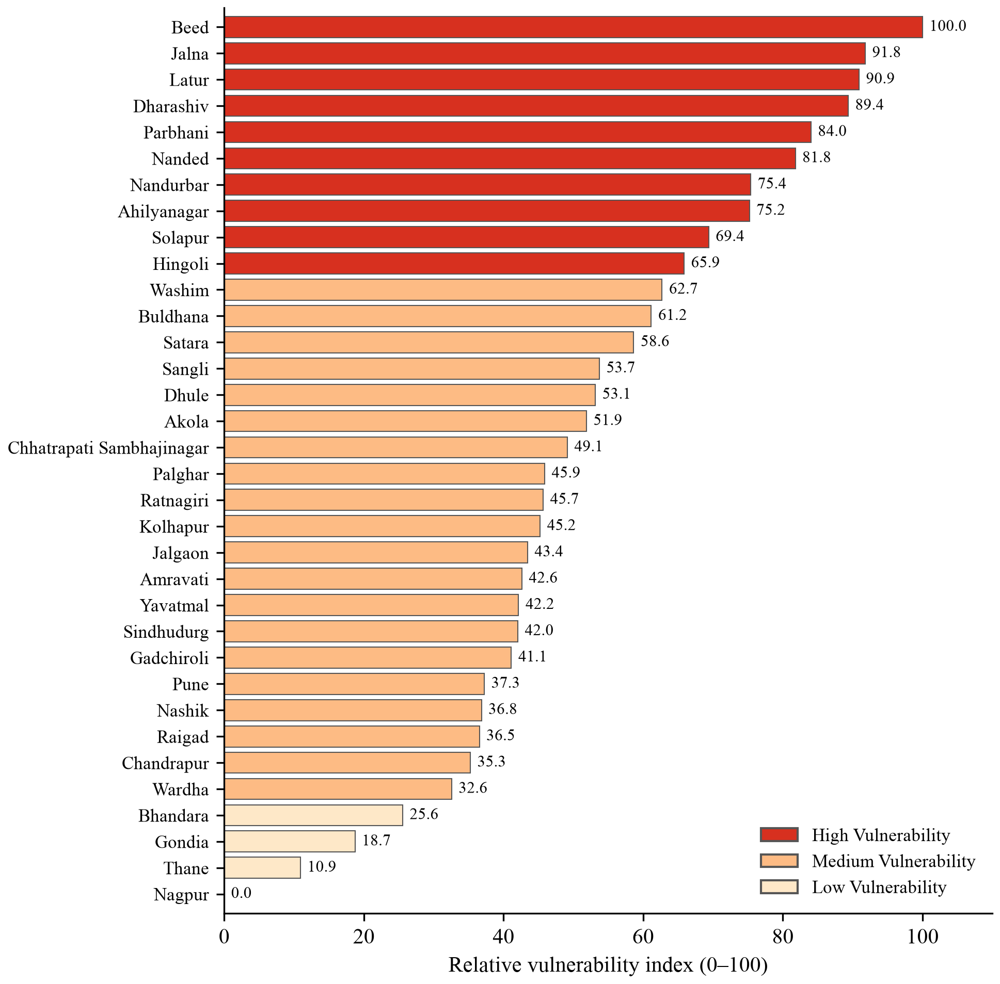{4.3}

## 8.5 Sensitivity and Robustness

TABLE: Table 8.4: Agreement of alternative index versions with the primary index
| Alternative version | Spearman ρ | Max. rank shift | Districts changing group |
| PCA absolute loadings, all 6 components | 0.995 | 3 | 1 |
| Pune flagged years excluded | 0.995 | 3 | 1 |
| Equal weights | 0.993 | 5 | 2 |
| Hazard and social sub-indices | 0.991 | 6 | 1 |
| ONI instead of RONI | 0.961 | 6 | 4 |
| OECD and JRC factor weights | 0.934 | 10 | 2 |

The district ranking is robust (Table 8.4). Every alternative version has a Spearman correlation of at least 0.934 with the primary index, at most four districts change group, and no district moves between Low and High in any version. The districts that change are close to a group boundary, for example Wardha (32.6), Hingoli (65.9), Washim (62.7) and Buldhana (61.2), and their group should be treated as less certain.

## 8.6 Drought Validation

TABLE: Table 8.5: Validation against drought declarations
| Item | 2018 | 2023 | 2026 (holdout) |
| Declaration stage | Final | Final | Trigger-1 |
| Talukas declared (main GR) | 151 | 40 | 265 |
| Districts with any declaration | 26 | 15 | 32 |
| Spearman ρ (index vs. share) | 0.585 | 0.450 | 0.545 |
| p-value (two-sided) | 0.0003 | 0.008 | 0.0009 |
| Mean share, Low group | 0.05 | 0.00 | 0.39 |
| Mean share, Medium group | 0.39 | 0.10 | 0.70 |
| Mean share, High group | 0.66 | 0.20 | 0.99 |
NOTE: n = 34 districts in every year. Share = talukas declared / Census 2011 talukas.

The index has a moderate positive association with the declared taluka share in all three years (Table 8.5, Figure 8.6). In 2018, the most informative year, districts with higher index values had a larger share of talukas declared (ρ = 0.585). The association is weaker in 2023 (ρ = 0.450), when most declarations were made by revenue circle instead of by taluka. In the 2026 holdout, examined only after the index was fixed, the association is similar (ρ = 0.545). In every year the mean declared share rises from the Low group to the Medium and High groups.

The disagreements are informative. Latur and Nanded in 2018, and Nanded and Parbhani in 2023, have high index values but few declared talukas, because much of their declaration was made at revenue-circle level. In 2026, Nagpur, the district with the lowest index, had all 14 talukas declared after a seasonal rainfall deficit of about 33 percent. These cases show the difference between long-term relative vulnerability and the outcome of a single season. The validation shows association, not causation, and does not show that the index predicts future droughts.

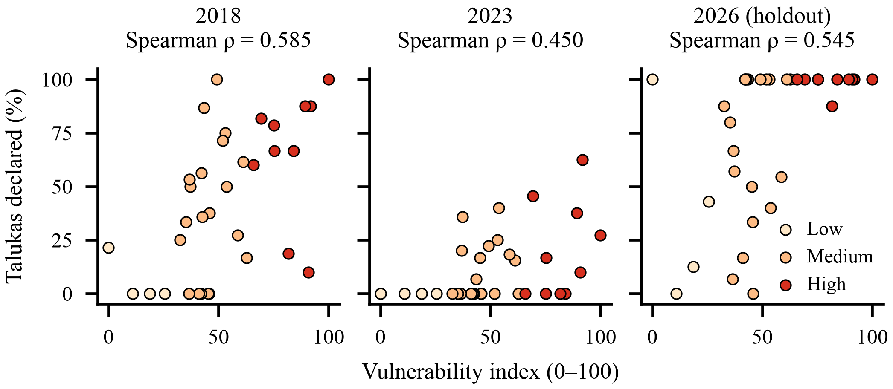{6.0}

## 8.7 Limitations

- The index covers only 34 districts, which limits statistical power; parallel analysis retains only one component.
- The KMO value of 0.40 shows weak common structure, so the weights are exploratory and close to equal weights.
- The socioeconomic and agricultural indicators refer to 2011 and 2010-11, and adaptive capacity is represented only by literacy because no verified district data on income, credit or infrastructure were available.
- Some published IMD rainfall values (notably Pune in 2005 and 2009) look implausibly high; they were kept as published.
- Drought declarations are administrative decisions, not direct measurements of crop loss, and the 2026 holdout is an early Trigger-1 stage.

# 9. Conclusion

This project developed an exploratory composite index of relative El Niño drought vulnerability for 34 districts of Maharashtra. Two El Niño-specific rainfall indicators, derived from 75 years of IMD gridded rainfall and NOAA's RONI, were combined with four agricultural and socioeconomic indicators from the Census 2011, the Village Directory and the Agriculture Census. PCA was used to derive sign-safe indicator weights from absolute loadings, the weighted sum was rescaled to a relative 0 to 100 index, and K-Means clustering grouped the districts into 10 High, 20 Medium and 4 Low vulnerability districts.

The results show that the highest vulnerability is concentrated in Marathwada and the adjoining dry interior, where large El Niño rainfall losses coincide with high dependence on rainfed agriculture and lower literacy. The weights were close to equal, the ranking stayed stable across six alternative methods (Spearman ρ between 0.934 and 0.995), and the index showed a moderate positive association with government drought declarations in 2018 (ρ = 0.585), 2023 (ρ = 0.450) and the 2026 holdout (ρ = 0.545).

The main strengths of the system are its transparency and reproducibility. All data come from official sources and are kept unchanged, every methodological choice is recorded, the validation data were kept separate from the model, and the results are available through maps and an interactive dashboard.

In conclusion, the system provides a transparent and reproducible basis for district-level drought preparedness screening in Maharashtra, as long as its relative and exploratory nature is respected.

## 9.1 Future Scope

- Update the socioeconomic indicators with the next census, and add verified adaptive-capacity indicators such as irrigation infrastructure, crop insurance coverage, credit access and income.
- Extend the analysis to taluka level and other drought-prone states, and strengthen the validation with crop-loss data and the final 2026 drought declaration.
- Deploy the dashboard online so that district officials and the public can use it before each monsoon.
